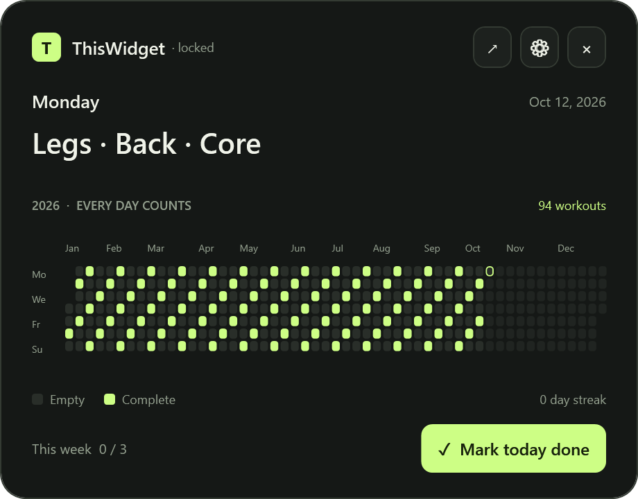
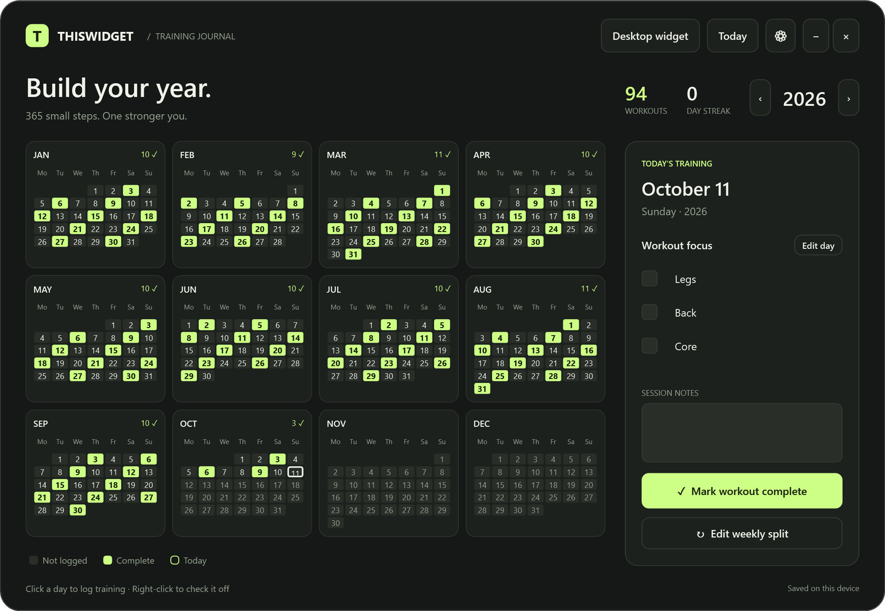

# ThisWidget

**Your training, one day at a time.** A free, open-source Windows workout calendar with a real desktop widget. See your whole year, today's focus, and every day you showed up.



## Download

Get **ThisWidget-Windows-x64.zip** from [Releases](https://github.com/ikymory/ThisWidget/releases/latest), extract it, and open **ThisWidget.exe**. The Windows x64 release includes its .NET runtime; you do not need to install .NET, Python or Node.

For a desktop and Start menu shortcut, run **Install.cmd** from the extracted folder. Installation is per-user and needs no administrator access. Or use the executable as a portable app. Your journal remains in your local app-data folder by default.

Built for Windows 11 x64. The release workflow can also build Windows ARM64; ARM64 execution has not been tested on hardware. macOS and Linux are not supported by this WPF app. Releases are currently unsigned.

## Use it

1. Open **Edit weekly split**. Enter what you train on each weekday, such as `Legs, Back, Core`. Empty days mean rest / no planned focus.
2. The widget starts pinned to your desktop, behind other apps, with its position locked. Click **↗** to open the calendar; **Desktop widget** adds it again if removed. The widget shows all 365 days, or 366 in leap years, plus today's weekday and focus. To reposition it, unlock it in Settings, drag its header, then lock it again.
3. Check individual exercises in the calendar or enable the widget checklist. Checking them all fills the day's box. **Mark today done** completes a session directly.
4. Click any widget box to open that date in the calendar. Right-click a date in either view for a quick completion toggle.

Future dates can be planned but cannot be completed early. Daily overrides affect one date. Logged sessions preserve their original focus when the weekly split changes. Notes save automatically.



Screenshots use demonstration history. A fresh installation starts with an empty journal.

## Settings

- Six accent presets or a custom `#RRGGBB` color; Obsidian and Paper themes.
- Separate calendar and widget sizes; widget opacity from 50% to 100%.
- Desktop attachment behind apps, or a floating widget with optional always-on-top.
- Position lock and reset position; show/hide widget and exercise checklist.
- Monday or Sunday week start; optional calendar day numbers.
- Weekly workout goal, streak and session counts.
- Optional reminder at a local time. It only fires for an unfinished, planned workout while the app is running. Windows notification preferences can suppress it. Reminders are off by default.
- Launch at Windows sign-in, backup export/restore, and calendar image export.

Scrollbars, sliders, checkboxes and text fields follow the selected theme. Long workout lists and settings panels remain scrollable.

**Ctrl+Alt+W** opens the calendar. The tray icon can reopen the app, show the widget, change settings or exit. Closing the calendar keeps the widget running; the widget's × removes it until you add it again.

Desktop attachment uses Explorer's desktop host. If Explorer is not ready at sign-in, desktop mode waits and retries; it does not become a floating overlay. After Explorer restarts, reopen the app if necessary.

## Your data

No accounts, ads, subscriptions, analytics or application network requests. Progress normally lives at `%LOCALAPPDATA%\ThisWidget\journal.json`. An installed app uses the journal beside its `app` folder, preserving the same profile when a packaged launcher redirects AppData. Shortcuts and Windows startup use the physical executable path. A previous-save `.bak` and safety copies protect recovery and imports. Export backups for long-term snapshots.

Earlier Yearform journals are copied on the first launch if a ThisWidget journal does not already exist. The original is preserved. The installer retires the old shortcut/startup entry only when they point to the former app installation.

Uninstall using the included **Uninstall.cmd**. It removes the app and its shortcuts while preserving your journal. See [data and recovery](docs/DATA.md).

## Build and test

Install the [.NET 10 SDK](https://learn.microsoft.com/en-us/dotnet/core/install/windows) on Windows, then:

```powershell
dotnet build src/ThisWidget -c Release
dotnet run --project tests/ThisWidget.Tests
dotnet run --project tests/ThisWidget.UiTests
```

For local Explorer attachment checks and generated previews:

```powershell
dotnet run --project tests/ThisWidget.UiTests -- docs/images --desktop
```

After installing, verify the running desktop widget and its Windows startup target with `./tests/Installation.Tests.ps1`.

Create a self-contained Windows release:

```powershell
./scripts/Publish.ps1 -Runtime win-x64
```

The script creates `artifacts/ThisWidget-Windows-x64.zip` and a SHA-256 checksum. `win-arm64` is also available for cross-publishing.

The app opens the fixed desktop widget by default. CLI: `--editor` also opens the calendar editor, `--background` starts only the tray/widget and respects the saved visibility preference, `--exit` gracefully stops the default journal instance, and `--data C:\path\journal.json` uses an independent journal without changing Windows startup.

## Architecture

`Model.cs` owns calendar rules and atomic JSON persistence. `AppController.cs` shares one journal across `MainWindow` and `WidgetWindow`, manages lifecycle and optional reminders. `Ui.xaml` provides the common control styles; `Theme.cs` applies palettes. `Native.cs` isolates desktop parenting, instance activation and the global shortcut. Tests exercise real model/storage behavior and WPF control events using isolated temporary journals.

## Contribute

MIT licensed: free to use, modify and redistribute, including commercially. See [CONTRIBUTING.md](CONTRIBUTING.md) for setup, tests and pull requests. [Report a bug](https://github.com/ikymory/ThisWidget/issues/new?template=bug_report.yml) with reproduction steps; do not attach your private journal unless you intentionally want to share it.
